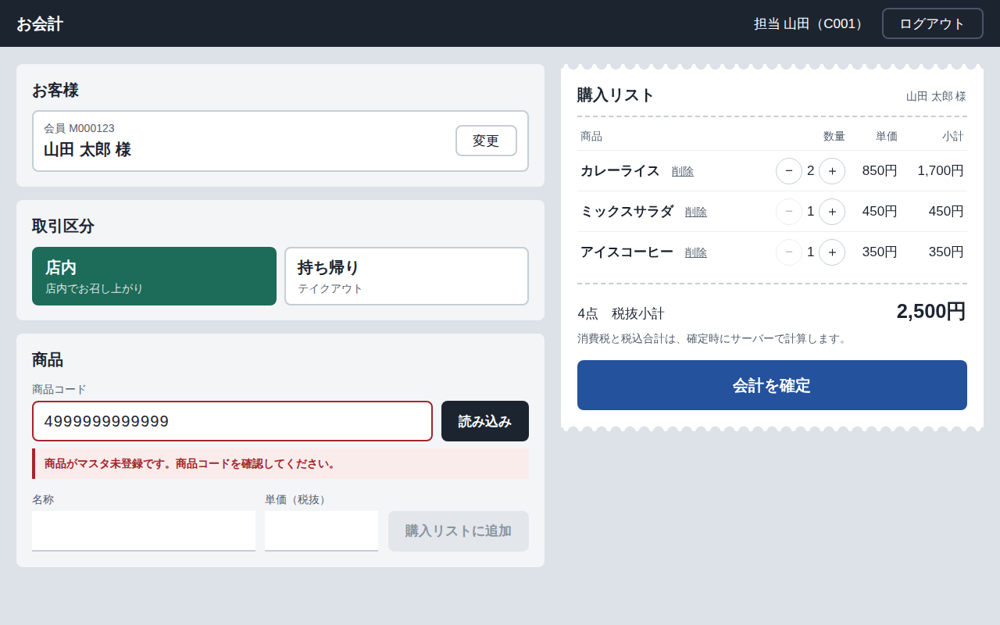

# 簡易POSアプリ（レストラン会計）

レジ担当者がログインし、会員ID（または非会員）と取引区分（店内／持ち帰り）を選んで商品コードから購入リストを作り、会計を確定するWebアプリです。

- 要件：簡易POSアプリ 要件定義書 1.3（追加検討）
- 設計：簡易POSアプリ 設計仕様書 v1.1
- テスト：簡易POSアプリ テスト設計書 v2.0



| 層 | 技術 | 本番想定 |
| --- | --- | --- |
| フロントエンド | Next.js 15（静的出力） | Azure Static Web Apps |
| バックエンド | FastAPI / SQLAlchemy 2 | Azure App Service（Linux、Always On） |
| DB | MySQL 8.0 | Azure Database for MySQL Flexible Server |

```
backend/    FastAPI（app/）、Alembic マイグレーション、シード／税率追加スクリプト、pytest
frontend/   Next.js（S-01 ログイン、S-02 POS 画面）、Jest
db/         スキーマ作成 SQL（手作業で流す場合用）
.github/    CI（テスト＋依存ライブラリの脆弱性スキャン）
```

## ローカルで動かす

### Docker を使う場合

```bash
docker compose up --build
```

http://localhost:3000 を開き、担当者 `C001` でログインします。開発用パスワードは `backend/scripts/seed.py` の `DEV_PASSWORD` です（本番では使わないこと）。

### 個別に起動する場合

```bash
# バックエンド（Python 3.12）
cd backend
pip install -r requirements-dev.txt
cp .env.example .env          # DATABASE_URL を自分の MySQL に合わせる
alembic upgrade head          # テーブル作成
python -m scripts.seed        # 開発用データ投入
uvicorn app.main:app --reload --port 8000

# フロントエンド（Node.js 20 以上）
cd frontend
npm install
npm run dev                   # /api は localhost:8000 に転送される
```

## 既存の MySQL に新しいスキーマ `pos_app` を追加する

Azure Database for MySQL など、既存のサーバーに追加する手順です。

1. 管理者ユーザーでスキーマとアプリ用ユーザーを作ります。`db/create_schema.sql` の `<STRONG_PASSWORD>` を自分の値に置き換えてから実行してください（パスワードを書いたファイルはコミットしないこと）。

   ```bash
   mysql -h <server>.mysql.database.azure.com -u <admin> -p --ssl-mode=REQUIRED < db/create_schema.sql
   ```

2. テーブルを作ります。マイグレーションは DDL 権限のある管理者ユーザーで実行します。

   ```bash
   cd backend
   DATABASE_URL='mysql+pymysql://<admin>:<password>@<server>.mysql.database.azure.com:3306/pos_app?charset=utf8mb4' \
   DB_SSL_CA=/etc/ssl/certs/ca-certificates.crt \
   alembic upgrade head
   ```

   Alembic を使えない環境では、`db/schema.sql` を流しても同じテーブルができます（Alembic から生成したものです）。

3. アプリの接続先は、アプリ用ユーザー `pos_app_user` の `DATABASE_URL` を App Service のアプリ設定（または Key Vault 参照）に設定します。

## 税率を変える（コード改修なし／F-008）

```bash
cd backend
python -m scripts.add_tax_rate --sales-mode DINE_IN --rate 0.12 --from 2027-04-01 --dry-run   # 確認だけ
python -m scripts.add_tax_rate --sales-mode DINE_IN --rate 0.12 --from 2027-04-01
```

同じ取引区分で期間が重なる登録は拒否します。現在有効な行（終了日なし）は新しい行の前日で締め、税率や開始日などの値は書き換えません。過去の取引は明細に保存した税率・単価のスナップショットを使うため変わりません。

## テスト

```bash
cd backend && pytest -q          # 実 MySQL が必要（TEST_DATABASE_URL、既定は pos_app_test を作り直す）
cd frontend && npm test          # Jest + Testing Library
```

テスト名にテスト設計書の ID（T-001 など）を付けています。自動化した範囲は次のとおりです。

| レベル | 自動テストで確認しているもの |
| --- | --- |
| UT | T-001〜004, 010, 018, 025, 027〜035, 048〜050, 073 |
| IT（API） | T-005〜008, 011〜016, 019〜021, 036〜042, 051, 052 |
| IT（画面） | T-008, 011, 012, 014〜017, 019, 020, 022〜024, 026, 038, 046, 053, 067 |
| ST（アプリ側） | T-055（HTTPS 強制）, 056, 057（CORS）, 058（SQLi）, 059（XSS）, 060（ヘッダー）, 061（エラー非開示）, 065, 066（接続プール）, 068, 069（ログ） |

Azure の設定確認（T-054, 062, 063, 070〜072 の ST構成）、レビュー（T-064, 074）、受入テスト（T-009, 043〜045, 047）は環境構築後に手作業で行います。

## 暫定で決めた仕様

テスト設計書 1.3 の仮値と設計仕様書 14 章の暫定方針を採用しています。正式に決まったら、該当箇所とテストの期待値を更新してください。

| 項目 | 暫定値 | 変更する場所 |
| --- | --- | --- |
| 単価 | 税抜 | — |
| 端数処理 | 切捨て（`FLOOR`） | `tax_rates.rounding_method` |
| 税率 | 店内 10%、持ち帰り 8% | `tax_rates`（`scripts/add_tax_rate.py`） |
| 商品コード | 数字 13 桁 | `app/models/schemas.py`、`frontend/lib/validation.ts` |
| 会員 ID | `M` + 数字 6 桁 | 同上 |
| パスワード | 8〜64 文字 | 同上 |
| ログインロック | 5 回失敗で 15 分 | 環境変数 `LOGIN_LOCK_THRESHOLD` / `LOGIN_LOCK_MINUTES` |
| セッション | 8 時間（8:00 ちょうどで失効） | 環境変数 `SESSION_TTL_MINUTES` |
| 数量 | 1〜99。100 個目は追加せずメッセージ表示 | `frontend/lib/cart.ts`、`TransactionItemIn` |
| 未登録会員 | エラー表示。非会員は「非会員として開始」を明示的に押す | — |
| 取引区分 | 1 取引 1 区分（混在は非対応） | — |

## 設計仕様書 v1.1 から補った点

- `cashiers` に `failed_login_count`・`locked_until` を追加しました（9.2 の一時ロックを実装するため）。
- `transactions` に対外表示用の `transaction_no`（`T` + JST 日付 + 内部連番）を追加しました（6.3）。
- ロック中のログインは通常の失敗と同じ `401 AUTH_FAILED` を返します。ロック状態から ID の存在を推測させないためです。
- 税額は取引の税抜合計に対して 1 回だけ端数処理し、明細の税額はそれを按分します（明細税額の合計＝取引の税額）。
- 状態を変える POST には独自ヘッダー `X-POS-Request: 1` を必須にしています（CSRF 対策の多層防御）。
- 本番の CSP は `unsafe-inline` を使わず、ビルド時（`npm run build`）にインライン script の SHA-256 を `out/staticwebapp.config.json` に書き込みます。デプロイには `out/` を使ってください。
- 本番では `/docs` などの API 仕様ページを公開しません。

## 本番構成のメモ

- フロントエンドとバックエンドは、Static Web Apps の「リンクされたバックエンド」で `/api` を App Service に転送し、同一オリジンで運用する前提です（Cookie は `SameSite=Lax`）。別オリジンにする場合は `COOKIE_SAMESITE=none` と `CORS_ALLOW_ORIGINS` を設定してください。
- App Service のスタートアップコマンドは `backend/startup.sh` を使います。Always On と HTTPS のみ（HTTPS Only）を有効にしてください。
- Azure へのデプロイ用ワークフローは、このリポジトリには含めていません。
